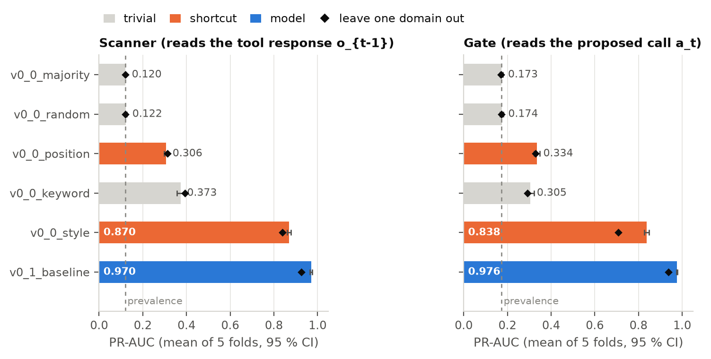
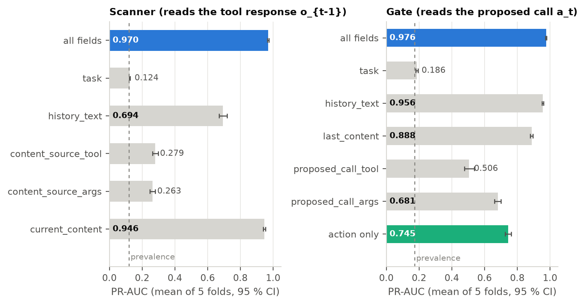
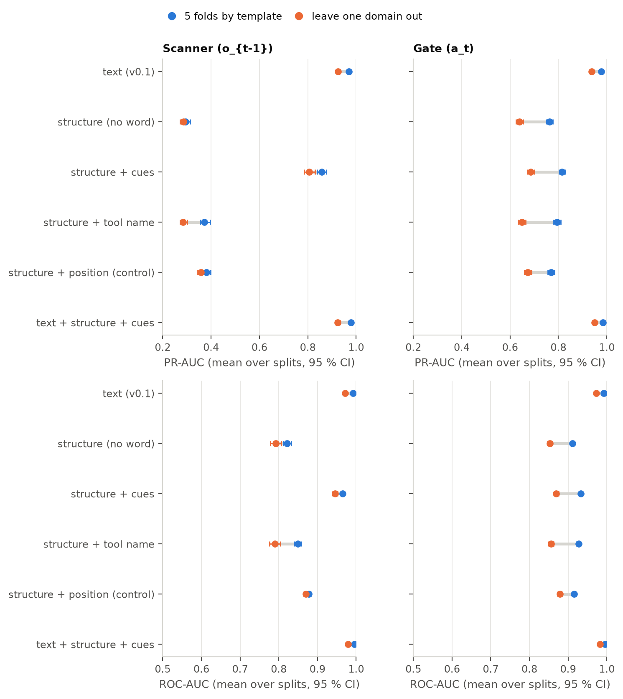
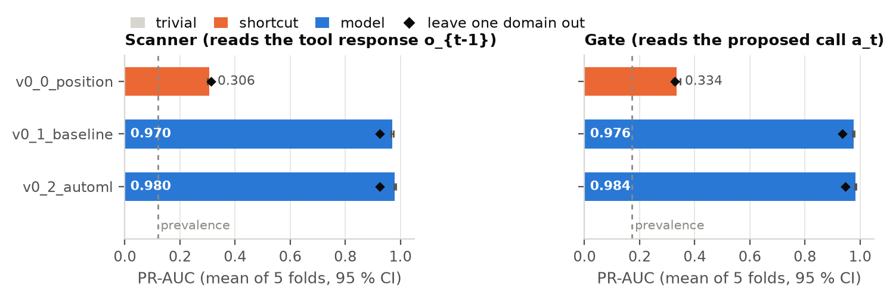
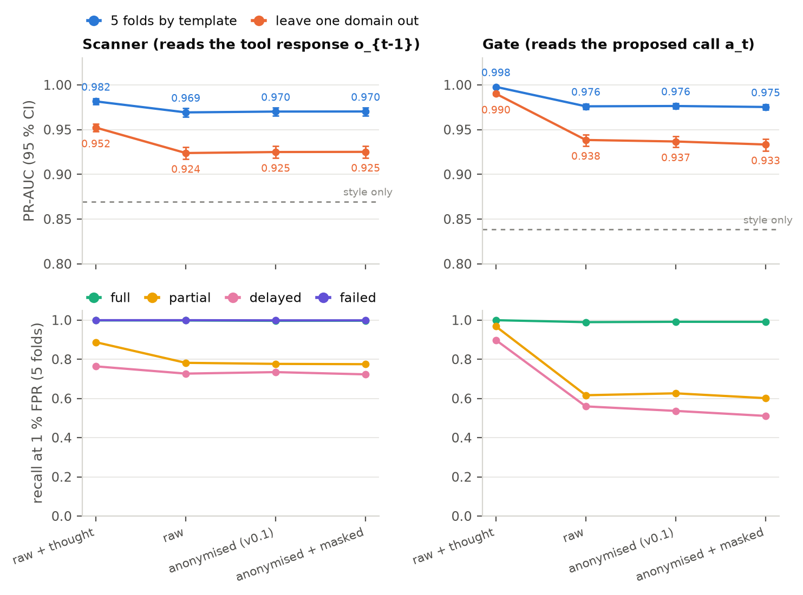

# Variables, baselines et AutoML — rapport de synthèse (module B)

> Projet AgentDrift Detection · ESILV 2026, groupe DIA 7 · rédigé le 26/11/2026
> Synthèse du deuxième module : transformer les données préparées par le module A en premiers détecteurs, les mesurer honnêtement et tester deux hypothèses (H1 et H3). Le détail des étapes est dans [PLAN_FEATURES.md](PLAN_FEATURES.md), les décisions et mesures datées dans [JOURNAL.md](JOURNAL.md), le module précédent dans [SYNTHESE_PREPARATION_DONNEES.md](SYNTHESE_PREPARATION_DONNEES.md).

---

## 1. En bref

Le module B construit les deux détecteurs du projet, le **scanner** (il lit la réponse d'outil qui vient d'arriver) et le **portail** (il juge l'action que l'agent s'apprête à exécuter), puis cherche **ce qu'ils apprennent vraiment**.

Quatre résultats à retenir :

1. **Un modèle simple et bien contrôlé atteint déjà environ 0,97 de PR-AUC** (la mesure principale, expliquée au §2) sur des tâches jamais vues. Un AutoML complet n'y ajoute que **+0,01**.
2. **Ce score est en grande partie du style, pas de la détection.** Un modèle qui ne regarde que la forme du texte (longueur, ponctuation, majuscules) obtient déjà 0,87. Et sur un domaine jamais vu, le score baisse de 0,97 à 0,92.
3. **H1 n'est pas soutenue.** Des variables sans aucun mot (quels types d'outils l'agent a appelés, d'où viennent ses arguments) ne généralisent pas mieux que les mots. Elles les complètent seulement, et seulement pour le portail.
4. **H3 n'est soutenue que pour le raisonnement de l'agent** (`thought`), qui n'existe pas en production : le retirer explique presque toute la chute de score. Anonymiser le monde et masquer les tics du générateur ne change presque rien au score, ce qui ne prouve pas que le style est neutralisé.

| PR-AUC | Tâches nouvelles, domaines connus | Domaine jamais vu |
|---|---|---|
| Aucun modèle (hasard) | 0,12 (scanner) · 0,17 (portail) | idem |
| Style du texte seul | 0,87 · 0,84 | 0,84 · 0,71 |
| **v0.1** : mots + régression logistique | **0,970 · 0,976** | **0,925 · 0,937** |
| v0.2 : AutoML | 0,980 · 0,984 | 0,924 · 0,946 |

Scanner · portail. Le chiffre le plus important du module est l'écart entre les deux colonnes et la ligne « style seul » : **la baseline apprend en partie le style du générateur, et seul un test sur ATBench (module D) pourra dire jusqu'où.**

---

## 2. Comment lire les chiffres

- **PR-AUC (précision–rappel).** Une note de 0 à 1 qui récompense un détecteur à la fois **précis** (ses alertes sont de vraies attaques) et **complet** (il en rate peu). Le hasard obtient la part d'attaques dans les données (12 % pour le scanner, 17 % pour le portail), pas 0,5.
- **ROC-AUC.** La probabilité que le détecteur donne un score plus haut à une attaque qu'à un cas normal pris au hasard. 0,5 = hasard, 1 = parfait. Elle ne dépend pas de la part d'attaques, donc sert à comparer les domaines.
- **Rappel à 1 % de fausses alertes.** On règle le seuil pour que le détecteur se trompe sur 1 cas normal sur 100, et on regarde la part d'attaques attrapées. C'est le point de fonctionnement d'un vrai garde-fou : un agent qui se bloque trop souvent est inutilisable.
- **Intervalle de confiance (IC 95 %).** La fourchette où le vrai score se trouve probablement. Les tâches d'un même gabarit se ressemblent, on rééchantillonne donc **par gabarit** (module A).
- **Tâches nouvelles / domaine jamais vu.** Deux façons de tester. Dans la première (5 plis par gabarit), le modèle a vu les 5 domaines à l'entraînement mais jamais la tâche testée. Dans la seconde, on retire un domaine entier (e-mail, banque, web, code, médical) à l'entraînement et on teste dessus : c'est le test de ce qui se transpose à une nouvelle application.

---

## 3. Démarche

Le module a suivi sept étapes, chacune mesurée avant de passer à la suivante :

```
Étape 0  Harnais d'expérience (plis, seuils, IC, comparaisons appariées)
   │
Étape 1  Bloc texte (TF-IDF par champ)
   │
Étape 2  Baselines v0.0 (repères et raccourcis) et v0.1 (mots + régression logistique calibrée)
   │
Étape 3  Blocs sans mots : structure, nom d'outil, provenance, indices d'injection
   │
Étape 4  Test de H1  ─────────────┐
Étape 5  AutoML v0.2              ├─►  mêmes plis, mêmes IC, comparables entre elles
Étape 6  Test de H3  ─────────────┘
```

Règles tenues : le test fixe n'oriente aucun choix, tout se règle sur l'entraînement (les seuils aussi), une même fonction d'évaluation sert pour tous les modèles, et chaque comparaison est **appariée** (les deux modèles sont évalués sur les mêmes lignes et les mêmes tirages de gabarits, l'intervalle porte donc sur leur différence). **273 tests automatiques** passent.

---

## 4. Ce que chaque détecteur voit

Le module A a défini deux **vues causales** : à l'étape *t*, un détecteur ne lit que ce qui est connu à ce moment.

| | Scanner | Portail |
|---|---|---|
| Question | « Cette réponse d'outil donne-t-elle des ordres à l'agent ? » | « L'action proposée sert-elle l'utilisateur ou l'attaquant ? » |
| Lit | la réponse d'outil de l'étape précédente, l'historique, la tâche | l'action proposée, l'historique, la tâche |
| Ne lit jamais | le raisonnement de l'agent, la réponse à l'action jugée, tout ce qui suit | idem |
| Part d'étapes attaquées | 12 % | 17 % |

Le texte peut être de trois variantes : **anonymisé** (défaut), **masqué** (anonymisé + tics du générateur effacés), **brut** (réservé à l'étape 6).

---

## 5. Les briques construites

### 5.1 Le bloc texte
Les mots (et paires de mots) de chaque champ sont comptés séparément (TF-IDF par champ) : un mot dans la réponse d'outil ne compte pas pareil que dans l'action. Les espaces réservés de l'anonymisation (`<CONTACT_k>`, `<EXT_EMAIL_k>`) sont gardés entiers, car « un inconnu extérieur » est une information utile.

### 5.2 Les blocs sans mots
| Bloc | Ce qu'il mesure |
|---|---|
| **Structure** | la catégorie de risque des outils appelés (lecture, envoi externe, paiement, suppression…) et leurs enchaînements, sans lire un seul nom d'outil |
| **Nom d'outil** | l'outil appelé (**contrôle**, pas une variable de production : les noms n'existent pas dans un domaine inconnu ni dans ATBench) |
| **Provenance** (portail) | l'argument de l'action vient-il de la demande, d'une réponse d'outil antérieure, ou d'une source nouvelle ? |
| **Indices d'injection** | adresse extérieure nouvelle, tournures impératives choisies à l'avance, longueur du texte |
| **Position** (contrôle) | l'étape où l'on se trouve, pour mesurer combien du score n'est que de la position |

Deux pièges que j'avais moi-même introduits ont été repérés par les contrôles du module et supprimés : un indicateur « il existe un résultat antérieur » (allumé sur 100 % des attaques du scanner, donc un raccourci de position) et un remplissage « aucun » dans les enchaînements (qui signalait « exactement un appel avant »).

### 5.3 Seuils et calibration
- **Seuil.** Il est fixé à partir des scores du modèle sur des sous-découpages internes de l'entraînement. Fixé sur les scores de l'entraînement lui-même, il donnait **2 à 3 fois** le taux de fausses alertes visé.
- **Calibration.** Les scores sont convertis en probabilités (méthode de Platt) : un score de 0,8 correspond alors à environ 80 % d'attaques. Écart de calibration (ECE) : **0,003**.

---

## 6. Les baselines (v0.0 et v0.1)

### 6.1 v0.0 : les repères

Des modèles volontairement faibles servent d'étalon pour savoir ce que « bon » veut dire.

| Modèle | PR-AUC scanner · portail | Ce qu'il apprend à nous dire |
|---|---|---|
| Classe majoritaire | 0,12 · 0,17 | le plancher |
| Hasard | 0,12 · 0,17 | idem, rappel à 1 % ≈ 1 % |
| Étape où l'on est (position) | 0,31 · 0,33 | ROC-AUC 0,84 · 0,78 : **la position suffit à bien ranger**, sans détecter quoi que ce soit |
| Mots-clés d'injection choisis à l'avance | 0,37 · 0,31 | une liste de mots écrite à la main est très insuffisante |
| **Style du texte seul** | **0,87 · 0,84** | le raccourci à battre : longueur, ponctuation, majuscules |

Le modèle « style seul » n'est pas une baseline sérieuse, c'est un **détecteur de triche** : s'il obtient autant que le vrai modèle, le vrai modèle triche aussi.

### 6.2 v0.1 : mots + régression logistique

Une régression logistique sur le texte, le paramètre de régularisation (C) étant choisi sur les sous-plis internes, puis calibrée.

| v0.1 | PR-AUC (IC 95 %) | Rappel à 1 % | FPR observé |
|---|---|---|---|
| Scanner, tâches nouvelles | **0,970** [0,965 ; 0,975] | 0,916 | 1,0 % |
| Portail, tâches nouvelles | **0,976** [0,973 ; 0,979] | 0,904 | 0,9 % |
| Scanner, domaine inconnu | 0,925 [0,918 ; 0,931] | 0,805 | 0,2 % |
| Portail, domaine inconnu | 0,937 [0,930 ; 0,943] | 0,805 | 0,3 % |



**Ce que révèle l'étude de v0.1** (variantes dans `results/runs/v0_1_study/`) :

- **Lire l'injection fait presque tout.** Sans elle, le portail (qui ne voit que la tâche, l'outil et ses arguments) tombe à **0,744**, et à **0,06 de rappel** sur les attaques partielles : un destinataire du même domaine ne se distingue pas par le texte seul.
- **Les mots les plus pesants sont des tics.** En lisant les coefficients à la main : « correction » (le tic des attaques partielles), « malicious » (68 lignes, 92,6 % d'attaques), les mots d'un gabarit particulier (`5000`, `invoice`, `2026`) qui n'existent que dans les cas « difficiles », et le nombre de `<result>`, qui compte en fait les étapes.
- **Les attaques retardées s'effondrent hors domaine** : rappel 0,28 (scanner) et 0,09 (portail) à seuil transféré, contre 0,73 et 0,54 en tâches nouvelles. Environ la moitié de cette chute vient du **seuil** : réglé sur 4 domaines, il laisse passer trop peu de fausses alertes sur le 5ᵉ (0,2 à 0,3 % observé au lieu de 1 %).
- **Un défaut du module A est apparu** : l'anonymiseur remplace parfois le nom de famille d'un personnage par `<CONTACT_k>` quand il coïncide avec un contact du monde (621 trajectoires). Non corrigé, noté.



---

## 7. H1 : des variables sans mots généralisent-elles mieux ?

**Hypothèse (H1).** Des variables qui ne contiennent aucun mot (structure, provenance) perdent moins de score quand on change de domaine que les mots, parce qu'elles décrivent *ce que fait l'agent* et non *comment c'est écrit*.

**Test.** Même modèle, même réglage ; seuls les blocs changent. On compare la perte de ROC-AUC « tâches nouvelles → domaine inconnu » (ROC-AUC, parce qu'elle ne dépend pas de la part d'attaques, très différente en banque).

| Variante | Scanner CV · inconnu | Portail CV · inconnu |
|---|---|---|
| Mots (v0.1) | 0,970 · 0,925 | 0,976 · 0,937 |
| Structure seule (sans mot) | 0,295 · 0,285 | 0,763 · 0,639 |
| Structure + indices d'injection | 0,858 · 0,806 | 0,815 · 0,686 |
| Mots + structure + indices | 0,979 · 0,924 | **0,984 · 0,949** |

(PR-AUC.)

**Résultat : H1 n'est pas soutenue.** Pour le portail, la structure perd **plus** que les mots (différence de perte de ROC-AUC −0,040, IC [−0,047 ; −0,034]). Pour le scanner, elle ne perd ni plus ni moins. La structure n'a **aucun signal** pour le scanner (PR-AUC 0,295 ≈ la position seule) : les réponses d'outil attaquées et normales appellent les mêmes catégories d'outils.



**Ce qui est utile malgré tout :**

- **Mots + structure aident le portail sur les attaques retardées en domaine inconnu** : rappel à fausses alertes égales 0,175 → 0,366. Le portail a besoin de savoir *ce que l'agent a déjà fait*, pas seulement ce qu'il a lu.
- **Ils n'aident pas le scanner.** Le même ajout laisse le scanner inchangé hors domaine.
- **Contrôles** : ajouter les noms d'outil dégrade encore (ils n'existent pas hors du domaine appris), et la position seule rapporte une grande part du signal de la structure sur le scanner, d'où l'importance de ne jamais l'inclure dans un modèle final.

Le **brouillon** de la table des risques d'outils (`tool_risk.yaml`) n'est pas encore validé par un relecteur (Oscar, KAN-58) : les résultats sur la structure seront à relancer après validation.

---

## 8. v0.2 : AutoML

**Principe.** Au lieu de choisir à la main, une recherche automatique (Optuna) teste 50 combinaisons par pli et garde la meilleure. Elle couvre les quatre briques du cours :

1. **Préparation** : texte manquant lu comme vide, imputation, mise à l'échelle.
2. **Variables** : quels blocs, quelles options de TF-IDF, sélection des meilleures colonnes (chi²).
3. **Modèles** : régression logistique, SVM linéaire, Naive Bayes, arbre, forêt, k plus proches voisins.
4. **Hyperparamètres** : réglés pour chaque famille, avec abandon précoce des essais peu prometteurs.

La recherche est **imbriquée** : refaite entièrement dans chacun des 20 plis d'évaluation, jamais sur les données qui servent à noter. Calcul : environ 80 minutes en tout.

**Ce qu'elle a choisi.**
- **Un modèle linéaire dans les 20 plis** (régression logistique 15 fois, SVM linéaire 5). Les autres familles, évaluées dans le même cadre, restent loin : Naive Bayes ≈ 0,92, forêt ≈ 0,88, k-NN ≈ 0,77. Sur des dizaines de milliers de colonnes de mots, un modèle linéaire est difficile à battre.
- **Des blocs de structure dans tous les plis**, y compris pour le scanner.

| PR-AUC (IC de la différence avec v0.1) | v0.1 | v0.2 | |
|---|---|---|---|
| Scanner, tâches nouvelles | 0,970 | 0,980 | +0,010 [0,008 ; 0,012] |
| Portail, tâches nouvelles | 0,976 | 0,984 | +0,007 [0,006 ; 0,009] |
| Scanner, domaine inconnu | 0,925 | 0,924 | −0,001, non significatif |
| Portail, domaine inconnu | 0,937 | 0,946 | +0,010 [0,006 ; 0,014] |

À fausses alertes égales sur domaine inconnu, le rappel des **attaques retardées du portail passe de 0,175 à 0,329** : c'est le seul gain qui compte, et il vient des blocs de structure que H1 avait déjà identifiés. Pour le scanner, le rappel à fausses alertes égales **baisse** (0,851 → 0,815).



**Limites de v0.2** (exigées pour ouvrir v0.3) :

1. **La recherche optimise pour les domaines connus.** Ses sous-découpages internes mélangent les domaines : elle retient donc de la structure pour le scanner, qui y est nuisible hors domaine.
2. **Les seuils du scanner sont trop permissifs hors domaine** (2 % de fausses alertes au lieu de 1 %) : une partie du gain de rappel vient de là.
3. **Saturation.** En domaines connus, les écarts entre bonnes configurations (~0,005) sont du bruit.
4. **Espace limité** : pas de TF-IDF par caractères, pas de boosting ni de modèle de langage.

**Un incident de calcul à retenir.** Le premier lancement semblait bloqué. En réalité, le portable était en veille capot fermé, et le garde-fou de temps d'Optuna (en heure murale) coupait certaines recherches à 3 essais au lieu de 50, **sans erreur**. Le budget compte maintenant le temps de calcul réel, hors veille, et le calcul a été relancé avec la machine maintenue éveillée. Sans cette détection, les résultats auraient été biaisés et non reproductibles.

---

## 9. H3 : une partie du score vient-elle des artefacts du générateur ?

**Hypothèse (H3).** Une part du score vient d'artefacts de génération (identité du monde, tics d'injection, montants récurrents, raisonnement de l'agent) et disparaît quand on les retire.

**Test.** Une échelle à quatre marches avec le modèle v0.1, chaque marche retirant une information (16 runs, mêmes plis) :

| Marche | Information retirée | PR-AUC scanner · portail (tâches nouvelles) | (domaine inconnu) |
|---|---|---|---|
| 2 bis. Brut + raisonnement | — | 0,982 · 0,998 | 0,952 · 0,990 |
| 3. Brut | le raisonnement de l'agent | 0,969 · 0,976 | 0,924 · 0,938 |
| 4. Anonymisé (= v0.1) | l'identité du monde | 0,970 · 0,976 | 0,925 · 0,937 |
| 5. Anonymisé + masqué | tics, codes, montants | 0,970 · 0,975 | 0,925 · 0,933 |



**Résultats.**

- **Le raisonnement de l'agent explique presque toute la chute.** Son retrait coûte **−0,052** de PR-AUC au portail en domaine inconnu (IC [−0,058 ; −0,047]) et fait tomber le rappel des attaques retardées du portail de 0,90 à 0,56. Or ce raisonnement « avoue » souvent l'attaque, et il n'existe pas chez un vrai garde-fou : c'est le plus gros artefact, et il est déjà exclu des modèles par défaut.
- **Anonymiser le monde ne change rien** au score (+0,001 pour le scanner, entre 0 et −0,002 pour le portail). Le module A avait montré que le monde seul permettait de deviner une attaque ; le texte ne s'en servait presque pas.
- **Masquer les tics ne change rien pour le scanner** (0,000) et presque rien pour le portail (−0,001 à −0,003), alors que le masquage retire 99 % des tics des injections complètes.
- **La sonde du type d'attaque reste à 0,952** après masquage (0,960 avant, hasard 0,25) : le texte d'une injection dit toujours si elle va réussir.
- **Portail « action seule »** (la tâche, l'outil, ses arguments, sans le texte lu) : 0,745 en tâches nouvelles, 0,513 en domaine inconnu, soit **0,23 à 0,42 de moins** que le portail complet. L'anonymisation lui coûte −0,057 hors domaine : le nom des personnes aide à reconnaître un destinataire connu.

**Conclusion prudente.** H3 est soutenue **pour le raisonnement**, pas pour le masquage. Mais le fait que le masquage ne change rien **ne prouve pas** que le modèle ne triche pas : le style du générateur se lit dans *ce que demande l'injection*, que le masquage ne doit pas effacer. La seule réponse est le test externe sur ATBench.

---

## 10. Limites et points ouverts

**Limites connues**
- **Le style du générateur n'est pas neutralisé.** Style seul 0,870 contre 0,970 pour le modèle complet : environ 0,10 de PR-AUC séparent le style de la détection, et rien ne dit que ces 0,10 sont de la vraie détection.
- **Un seul générateur** de données : tout ce module mesure ce qui transpose entre domaines d'AgentDrift, pas entre agents.
- **Le scanner est aveugle** à une part des injections partielles et retardées, qui n'ont aucun indice visible dans le texte (module A). Ni la structure ni l'AutoML ne l'aident.
- **Transfert de seuil.** Un seuil réglé sur 4 domaines donne 0,2 % ou 2 % de fausses alertes sur le 5ᵉ au lieu de 1 % : à traiter par domaine (module D).
- **Brouillon de `tool_risk.yaml`**, pas encore validé : les résultats sur la structure sont provisoires.
- **Défaut de l'anonymiseur** (621 trajectoires) : à corriger dans le module A.
- **Le test fixe n'a pas été utilisé.** Tous les chiffres sont en validation croisée sur le développement.

**Pistes de v0.3**
- Sélection par domaine exclu plutôt que par plis mélangés.
- Blocs choisis par vue d'après H1 (structure seulement pour le portail).
- Boosting sur texte + structure (KAN-23).
- Calibration et seuil par domaine (D.2 / D.5).

**Ouvert côté équipe**
- Test ATBench (D.6, décision n° 5 sur son anonymisation).
- Validation de `tool_risk.yaml` (KAN-58) et relecture de Brier / ECE (module D).
- Sections B du rapport LaTeX (KAN-41), entrées d'`AI_AUDIT.md` et de `CONTRIBUTIONS.md`.
- Rejouer l'échelle H3 avec v0.2 (même commande, autre config).

---

## 11. Reproduire

```bash
python -m agentdrift.pipelines.build_views --raw             # vues scanner / portail (+ texte brut pour H3)
python -m agentdrift.pipelines.run_baseline                  # v0.0 et v0.1 : tableau comparatif
python -m agentdrift.pipelines.run_v01_study                 # étude de v0.1 (calibration, champs, courbes, coefficients)
python -m agentdrift.pipelines.run_blocks_check              # contrôle des blocs sans mots (provenance, position)
python -m agentdrift.pipelines.run_h1                        # test de H1
caffeinate -is python -m agentdrift.pipelines.run_automl     # v0.2, ≈ 80 min : garder la machine éveillée
python -m agentdrift.pipelines.run_h3                        # test de H3, ≈ 40 min
pytest                                                       # 273 contrôles automatiques
```

Toutes les étapes sont déterministes (graine 42). Chaque chiffre de ce rapport vient d'un `metrics.json` ou d'un tableau de `results/runs/` ; les figures sont dans `results/figures/` (PDF dans `report/latex/figures/`).
