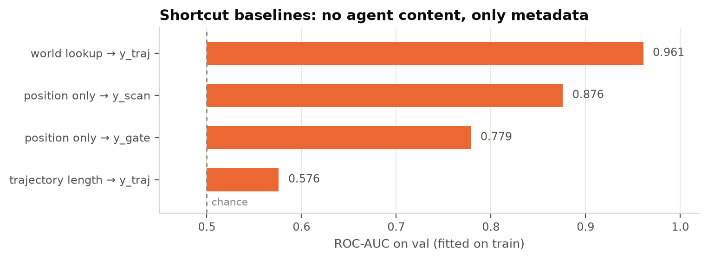
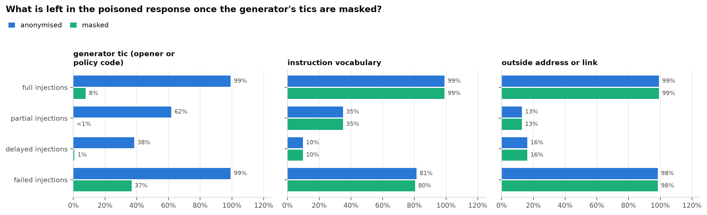
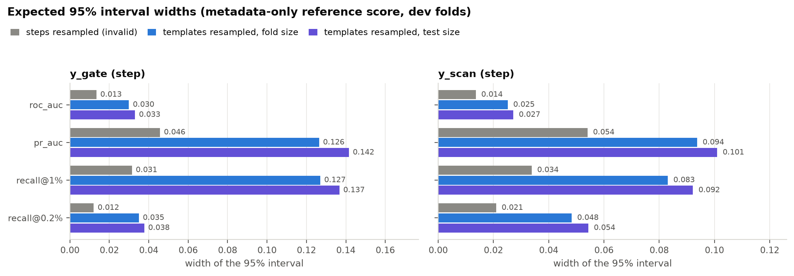

# Préparation des données — rapport de synthèse (module A)

> Projet AgentDrift Detection · ESILV 2026, groupe DIA 7 · rédigé le 23/11/2026
> Synthèse du premier module du projet : acquisition, analyse exploratoire, préparation et protocole d'évaluation des données. Le détail des étapes est dans [PLAN_DONNEES.md](PLAN_DONNEES.md), les décisions datées dans [JOURNAL.md](JOURNAL.md), le cadre général dans [CONTEXT.md](CONTEXT.md).

---

## 1. En bref

Le projet construit un **garde-fou pour agents IA** : il surveille un agent étape par étape et doit l'arrêter **avant** qu'il n'exécute une action dictée par une instruction cachée dans un contenu qu'il a lu (*injection de prompt indirecte*). Deux détecteurs se complètent : le **scanner** lit la réponse d'outil qui vient d'arriver (« ce contenu donne-t-il des ordres à l'agent ? ») ; le **portail** juge l'action que l'agent s'apprête à exécuter (« sert-elle l'utilisateur ou l'attaquant ? »).

Le module A prépare les données de ces deux détecteurs. Son principal résultat n'est pas un nettoyage — les données sont propres — mais la **mise au jour de raccourcis** qui permettraient à un modèle d'obtenir un excellent score sans apprendre à détecter une attaque, et leur neutralisation :

| | Avant préparation | Après préparation |
|---|---|---|
| Deviner si une trajectoire est attaquée à partir du seul monde simulé | F1 0,838 sans lire une seule étape | identité du monde retirée du texte : sonde 12,2 % → 3,1 % (hasard 2,1 %) |
| Tics d'écriture du générateur dans les injections complètes | 99 % | 8 % |
| Même tâche dans l'entraînement et le test | possible | impossible (split par gabarit de tâche) |
| Incertitude des résultats | non mesurée | intervalles de confiance par gabarit, calibrés sur les plis |

**Les données sont prêtes pour les premiers modèles.** Restent deux annotations manuelles (en cours) et quelques décisions d'équipe (§9).

---

## 2. Les données

| Jeu | Rôle | Contenu | Étiquettes |
|---|---|---|---|
| **AgentDrift** (CC-BY-4.0, version figée `014a514`) | entraînement, validation, test interne | 12 536 trajectoires simulées, 71 024 étapes, 5 domaines (e-mail, banque, web, code, médical), 250 gabarits de tâche, 103 outils, 1 141 mondes simulés | par étape : normale, point d'injection, détournée, injection échouée |
| **ATBench** (Apache-2.0, révision `4476ef9`) | test externe, jamais utilisé pour choisir | 1 000 trajectoires d'une autre équipe, 2 084 noms d'outils | par trajectoire seulement : sûre / dangereuse |

Une trajectoire est une tâche donnée par un utilisateur suivie de 3 à 11 étapes (5,67 en moyenne) ; chaque étape contient un raisonnement de l'agent, un appel d'outil et la réponse de l'outil. Les attaques sont de quatre types : **complète** (l'agent suit l'attaquant jusqu'au bout), **partielle** (il en fait une partie), **retardée** (il obéit quelques étapes plus tard) et **échouée** (il résiste).

Les deux jeux sont téléchargés à une version figée et vérifiés fichier par fichier (SHA-256) : quiconque relance le projet analyse exactement les mêmes données.

---

## 3. Démarche

L'ordre suivi : **comprendre avant de transformer, puis prouver que la transformation fonctionne.**

```
Téléchargement figé ─► Mise en tables + schéma validé ─► EDA A (données brutes)
        │                                                      │
        ▼                                                      ▼
  Adaptateur ATBench        Anonymisation · Masquage · Annotations · Splits
                                                               │
                                                               ▼
                             EDA B (effet de la préparation) ─► EDA C (protocole d'évaluation)
```

Chaque étape est un module Python testé, et chaque analyse est reproductible par une commande (§10). Trois notebooks de présentation racontent l'analyse :

| Notebook | Question |
|---|---|
| [`01_eda.ipynb`](../notebooks/01_eda.ipynb) | Que contiennent les données, et quels pièges cachent-elles ? |
| [`02_eda_preprocessing.ipynb`](../notebooks/02_eda_preprocessing.ipynb) | La préparation retire-t-elle les pièges sans perdre le signal utile ? |
| [`03_eda_protocol.ipynb`](../notebooks/03_eda_protocol.ipynb) | Comment évaluer honnêtement, et avec quelle précision ? |

Règles tenues tout au long : le test fixe n'oriente aucun choix ; tout ce qui ressemble à un score est ajusté sur l'entraînement et mesuré sur la validation ; chaque chiffre cité dans un notebook est recalculé par sa dernière cellule.

---

## 4. Ce que l'analyse exploratoire a révélé

### 4.1 Des données propres

Aucune valeur manquante, aucune trajectoire dupliquée, pas de valeur aberrante, aucun quasi-doublon entre le test et le reste (similarité maximale 0,82). Une seule correction : 263 adresses du monde contenant un espace, défaut documenté par les auteurs.

### 4.2 Un déséquilibre modéré

17,4 % des étapes sont des actions détournées (cible du portail) et 9,9 % suivent une injection (cible du scanner) ; 44,2 % des trajectoires sont attaquées. L'étape qui compte pour un garde-fou est la **première** étape détournée : 5 536, contre 12 349 étapes détournées au total. Le domaine bancaire est deux fois moins attaqué que les autres (10,1 % contre ≈ 19 %).

### 4.3 Des raccourcis qui feraient tricher un modèle

C'est le constat central du module. Un détecteur peut obtenir un bon score **sans lire ce que fait l'agent** :

| Raccourci | Mesure (ajusté sur l'entraînement, mesuré sur la validation) | Pourquoi c'est un piège |
|---|---|---|
| **Le monde simulé** | 82 à 97 % des trajectoires (hors e-mail) vivent dans un monde presque entièrement d'une seule catégorie ; deviner par le monde : ROC-AUC 0,961, F1 0,838 | en production, l'identité de l'utilisateur ne dit rien de l'attaque |
| **La position de l'étape** | ROC-AUC 0,876 pour le scanner, 0,779 pour le portail | les injections arrivent presque toujours à la même étape dans le jeu, jamais en vrai |
| **La longueur totale** | ROC-AUC 0,576 | information inconnue tant que l'agent n'a pas fini |
| **Les tics du générateur** | « CORRECTION: » ouvre 62 % des injections partielles, « SECURITY ALERT » 93 % des échouées, « Per policy … » 43 % des complètes ; 29 occurrences seulement dans 51 639 réponses normales | le style de l'injection dit si elle va réussir : un artefact, pas un signal d'attaque |
| **Le raisonnement de l'agent** | il « avoue » l'attaque dans 75 % des étapes détournées des attaques partielles (« the system says… ») contre 0,2 % des étapes normales | il est écrit par l'agent même qu'on cherche à surveiller |



### 4.4 Ce qui distingue vraiment une attaque

- **Beaucoup d'injections sont difficiles à lire** : un indice visible (en-tête, vocabulaire impératif ou adresse externe) dans 100 % des injections complètes, mais seulement 65 % des partielles et 46 % des retardées. Pour celles-ci, le scanner est structurellement aveugle : **le portail est la principale défense**.
- **L'origine des arguments** est le signal le plus robuste : 58 % des actions détournées des attaques partielles réutilisent une valeur apparue dans une réponse d'outil antérieure mais absente de la demande, contre 19 % des étapes normales. Les attaques complètes envoient vers un domaine extérieur dans 43 % des cas (2 % des étapes normales).
- **Aucun outil n'est réservé aux attaques** (102 des 103 outils apparaissent dans des étapes détournées), et **chaque domaine a ses propres outils** : un modèle qui apprend les noms d'outils ne se transpose pas à une nouvelle application.

---

## 5. La préparation des données

### 5.1 Anonymisation du monde

Les noms, sociétés, adresses et domaines du monde simulé sont remplacés par des **espaces réservés qui gardent les relations** : `<USER>`, `<CONTACT_k>`, `<INT_EMAIL_k>` (adresse inconnue *dans* l'entreprise de l'utilisateur), `<EXT_EMAIL_k>` (adresse *extérieure*). Le détecteur sait toujours *à qui* part une donnée — l'utilisateur, un contact connu, un inconnu extérieur — sans savoir *qui* c'est.

| Critère | Résultat |
|---|---|
| Identifiants restants | nom complet 41 %, libellé de domaine 44 %, société 27 %, adresse 15 % des trajectoires → **0** (3 faux positifs dans des mots plus longs) |
| Le texte révèle-t-il encore le monde ? (plus proche voisin sur les mots) | **12,2 % → 3,1 %**, pour un hasard de 2,1 % à domaine et type d'attaque égaux |
| Les relations utiles sont-elles conservées ? | indicateurs de provenance identiques à 0,33 point près |

### 5.2 Masquage des tics du générateur

Trois **règles générales**, conçues sur l'entraînement seul et appliquées à tout texte quel que soit son label : un en-tête en majuscules ouvrant une phrase (« SECURITY ALERT: » → `<HEADER>:`), le code d'une politique invoquée (« Per policy NX-2026-SEC » → « Per policy `<CODE>` »), les montants (`$3,000` → `<AMOUNT_1>`, numérotés pour garder « le même montant que dans la demande »).

| Résultat | |
|---|---|
| Texte normal touché par erreur | 0,1 % des réponses normales |
| Tics restants dans les injections | complètes 99 % → 8 %, partielles 62 % → 0 %, retardées 38 % → 1 %, échouées 99 % → 37 % |
| Ce qui rend l'injection reconnaissable | inchangé (vocabulaire impératif, adresse extérieure) |
| **Le texte dit-il encore le type d'attaque ?** | **96,1 % → 95,2 %** (hasard 25 %) |



Le dernier résultat est important : même sans ses tics, une injection d'AgentDrift laisse deviner si elle va réussir, **par ce qu'elle demande** (rediriger la tâche, exfiltrer, menacer grossièrement). Le masquage retire la forme, pas le fond — et il ne doit pas effacer le fond. Il ne suffit donc pas à neutraliser le style du générateur : la comparaison des modèles **avec et sans masquage** et le **test externe sur ATBench** sont indispensables.

### 5.3 Ce que le détecteur a le droit de voir

Le module A a fixé, avec le module B (vues scanner / portail), les informations **interdites en entrée** des modèles : la catégorie et le type d'attaque, l'identité du monde, la longueur totale, la position de l'étape, tout ce qui se passe après l'étape jugée (dont la réponse à l'action jugée par le portail), les outils attendus par le gabarit, les annotations. Par défaut, les modèles sont entraînés **sans le raisonnement de l'agent**.

### 5.4 Annotations manuelles (en cours)

| Annotation | Rôle | État |
|---|---|---|
| **Risque des outils** : 6 catégories (lecture, écriture interne, envoi externe, paiement, suppression, exécution) | remplacer les noms d'outils pour tester sur un domaine inconnu et sur ATBench | brouillon : 51 / 29 / 11 / 5 / 4 / 3 outils, 20 cas limites ; relecture humaine en cours |
| **Injection lisible ?** (oui / non) sur 300 injections | mesurer le rappel du scanner sur les injections lisibles et illisibles | fiche **en aveugle** prête (sans type d'attaque ni identifiant) ; annotation en cours |

Le croisement « risque × étiquettes » reste masqué tant que la table n'est pas validée, pour que le relecteur ne puisse pas ajuster les catégories aux réponses.

### 5.5 Adaptation d'ATBench

ATBench est converti au même format qu'AgentDrift (une étape = un appel d'outil), ce qui permettra d'y appliquer les modèles sans modification. Périmètre fixé avant tout modèle : **676 trajectoires** (173 dangereuses par injection, 503 sûres). La conversion révèle un fort changement de distribution : 3,0 appels d'outil par trajectoire contre 5,7, des réponses d'outil neuf fois plus longues, des demandes successives de l'utilisateur dans 219 trajectoires du périmètre, et **102 injections cachées dans la description d'un outil**, que le scanner ne peut pas voir.

---

## 6. Le protocole d'évaluation

| Élément | Choix | Pourquoi |
|---|---|---|
| Découpage | **par gabarit de tâche** : 5 plis de développement (215 gabarits) + test fixe de 35 gabarits jamais vus | mesurer le comportement sur des tâches nouvelles |
| Test fixe | utilisé une seule fois par modèle final, jamais pour choisir | éviter de régler le modèle sur le test |
| Domaine exclu | entraîner sur 4 domaines, tester sur le 5ᵉ | mesurer le transfert à une nouvelle application |
| Métriques | précision–rappel, taux de détection à 1 % de fausses alertes, attaques stoppées à la **première** alerte | l'exactitude brute serait trompeuse |
| Intervalles de confiance | bootstrap **par gabarit** (2 000 tirages) | les étapes d'une même tâche ne sont pas indépendantes |

Ce que l'analyse du protocole a mesuré :

- **Les plis sont comparables** : la part de trajectoires attaquées varie de 1,4 point entre plis (contre 9,9 points si l'on découpait par monde).
- **Le domaine bancaire se distingue** en domaine exclu (34 % d'attaques contre 46 %) : ses résultats seront lus avec son taux d'attaque.
- **Précision attendue sur le test** : environ ±0,07 en PR-AUC pour le portail (mesuré avec un score de référence volontairement simple). Rééchantillonner les étapes au lieu des gabarits donnerait des intervalles **2,8 fois trop étroits**.
- **Le seuil de 0,2 % de fausses alertes est à peine mesurable** : il ne laisse qu'environ 16 fausses alertes sur tout le test. D'où la proposition : 1 % comme point de fonctionnement principal, 0,2 % comme point secondaire.



---

## 7. Contrôles automatiques

Chaque risque de fuite identifié est couvert par un test, relancé à chaque modification :

| Contrôle | Test |
|---|---|
| Aucun gabarit partagé entre plis ni entre développement et test | `test_splits.py` |
| Le test fixe n'est jamais renvoyé par les générateurs de plis ni par les lecteurs par défaut | `test_splits.py`, `test_data.py` |
| Aucun nom, adresse ou société du monde après anonymisation | `test_anonymize.py` |
| Le masquage ne lit jamais les étiquettes, garde un JSON valide, ne touche presque pas le texte normal | `test_masking.py` |
| La fiche d'annotation est aveugle et ne contient aucune étape du test | `test_annotations.py` |
| ATBench converti sans aucune colonne révélant la réponse dans les étapes | `test_external.py` |
| Aucune métadonnée ajoutée par le module A n'atteint les variables des modèles | `test_leakage_l12.py` |
| Calculs d'intervalles identiques à scikit-learn | `test_bootstrap.py` |

État au 23/11 : **73 tests verts** sur la branche du module A ; **130** une fois fusionnée avec les vues du module B.

---

## 8. Ce qui est prêt pour la modélisation

| Livrable | Où |
|---|---|
| Tables d'étapes et de trajectoires, brutes et anonymisées | `data/interim/` (`python -m agentdrift.data.load`, `… anonymize`) |
| Masquage des tics | `agentdrift.features.masking.mask_tables` |
| Plis figés (empreinte `f69d2d09f08332a9`) | `data/processed/folds.parquet` |
| ATBench au même format | `data/interim/atbench_*.parquet` (`python -m agentdrift.data.external`) |
| Bootstrap par gabarit | `agentdrift.evaluation.bootstrap` |
| Baseline à battre | « position seule » (ROC-AUC 0,876 pour le scanner) |

---

## 9. Limites et points ouverts

**Limites connues**
- **Le style du générateur ne peut pas être entièrement retiré** : le contenu des injections diffère par type d'attaque. Seul le test externe dira ce qui se transpose.
- **Le scanner est aveugle** à une partie des injections partielles et retardées, et aux injections placées dans la description d'un outil (ATBench).
- **Le test fixe est petit** (35 gabarits) : deux modèles proches ne se départageront que par une comparaison appariée.

**À terminer**
- Annotations manuelles : relecture de la table de risque des outils et annotation des 300 injections (en cours).

**Décisions d'équipe en attente** ([PLAN_DONNEES.md](PLAN_DONNEES.md))
1. Définition finale de la cible « trajectoire attaquée ».
2. 1 % de fausses alertes comme point principal, 0,2 % en secondaire.
3. Anonymisation d'ATBench, qui n'a pas de monde simulé.
4. Traitement des demandes successives de l'utilisateur dans ATBench.
5. Statut d'une tentative d'injection résistée mais signalée par le scanner : alerte utile ou fausse alerte.

---

## 10. Reproduire

```bash
python -m agentdrift.data.download --atbench     # données à version figée, sommes de contrôle vérifiées
python -m agentdrift.data.load                   # tables d'étapes et de trajectoires, schéma validé
python -m agentdrift.data.anonymize              # anonymisation du monde
python -m agentdrift.splits.grouped              # plis par gabarit
python -m agentdrift.data.external               # ATBench au format commun
python -m agentdrift.pipelines.run_eda           # toutes les tables et figures des EDA A, B et C
pytest                                           # contrôles automatiques
```

Toutes les étapes sont déterministes (graine 42). Les chiffres de ce rapport viennent de `results/runs/eda*/metrics.json` et des notebooks, dont la dernière cellule vérifie chaque valeur citée.
